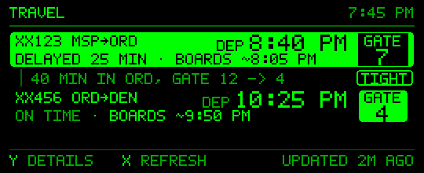
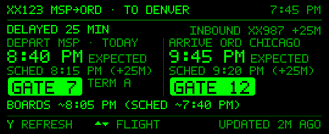
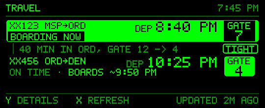
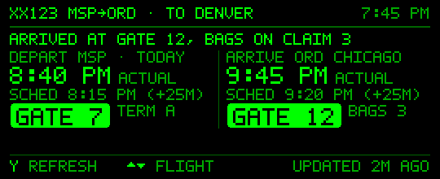
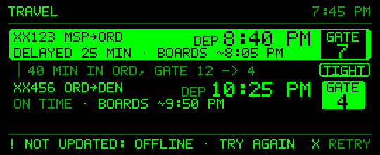
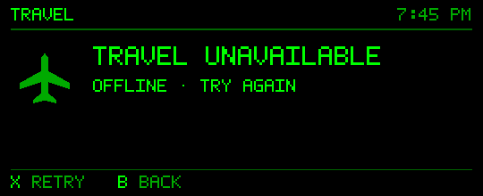

# Travel

Flight tracking for a smart-glasses companion app: status, delays, gate changes, estimated boarding times
and connection alerts, from [FlightAware AeroAPI](https://www.flightaware.com/commercial/aeroapi/) v4.

A small gateway engine polls each tracked flight adaptively (AeroAPI is billed per call), works out the
connections between flights, and writes one merged notification per change, popping up only what matters
within the hour. An Android library decodes the gateway's JSON and builds what the glasses show.

| Flight list | Flight detail | Boarding |
| --- | --- | --- |
|  |  |  |
|  |  |  |

The screens (540x220, monochrome green) are rendered by a host app from this library's rows; they are
shown here for reference and use made-up flights.

## Layout

- `server/travel.mjs`: the engine. AeroAPI adapter, flight picking and status mapping, estimated boarding,
  the adaptive poller, connections and the notification rubric. Plain ES modules, Node 20+, no dependencies.
- `server/routes.mjs`: the HTTP routes (`GET /travel`, flights, refresh, settings) for a host router.
- `server/test/`: `node:test` suites with a fake AeroAPI, an in-memory store, event bus and router.
- `android/travel`: Android library module `:travel`, package `glasses.travel`. Wire models
  (`TravelFlight`, `TravelSnapshot`, ...) and `TravelFormat` (JSON decoding, failure messages, clocks in
  airport zones, list rows). Screens, storage and transport belong to the host.
- `docs/spec.md`: the full contract (routes, JSON shapes, poller cadence, connection rules, notifications).

## AeroAPI key

Create an AeroAPI key (the personal tier is enough for a few flights) and make it available to the host's
secret lookup under the name `FLIGHTAWARE_AEROAPI_KEY`. The engine asks for it on each poll with
`ctx.secret('FLIGHTAWARE_AEROAPI_KEY', { optional: true })`, sends it only as the `x-apikey` header to
`aeroapi.flightaware.com`, and never logs it. Without a key, flights can still be added and listed; each one
reports `error: "no_provider"`.

## Wiring a host gateway

The engine takes everything from a `ctx` object:

| `ctx` member | Used for |
| --- | --- |
| `fetch(url, opts)` | AeroAPI requests (WHATWG fetch; tests inject a fake) |
| `now()` | the clock, epoch ms |
| `store` | documents: `all(c)`, `get(c, id)`, `put(c, doc) -> doc`, `del(c, id) -> bool`, `flushed()` |
| `events.publish(type, data, opts)` | `travel` change hints (`{supersede: true}`) and `notification` rows |
| `secret(name, opts)` | the AeroAPI key |
| `log(line)` | optional diagnostics (`travel provider_429`, ...) |
| `config.tz` | the wearer's home zone, for "today" and fallback clocks (default `UTC`) |
| `config.travelNotify`, `config.travelTickMs` | start the poller on register; tick interval (default 60 s) |

```js
import { register } from './vendor/rayneo-travel/server/routes.mjs';
import { setHttpError } from './vendor/rayneo-travel/server/travel.mjs';

setHttpError(HttpError);            // optional: throw the host's error class (status, message)
register(router, ctx, {
  readJson,                          // optional: the host's JSON body reader
  scope: ['phone'],                  // optional: passed through as route options
  poll: isWorkerProcess,             // run the poller in one process only
});
```

Routes are `r.get/post/put/del(path, handler, opts)`; a handler receives `{ req, params }` and returns a JSON
value, and errors carry an HTTP `status` and a machine-readable `message` such as `airline_required`. The
engine's functions (`addFlight`, `travelView`, `removeFlight`, `getSettings`, `saveSettings`, `refreshAll`)
can also back agent tools directly, so they work while the phone is offline.

Hosts that deploy from `git archive` must copy the submodule's `server/` directory as well; submodule
content is not in the archive.

## Wiring a host Android app

Add this repository as a Git submodule (for example at `android/travel-lib`), then in the host's
`settings.gradle.kts`:

```kotlin
include(":travel")
project(":travel").projectDir = file("travel-lib/android/travel")
```

and in the app module: `implementation(project(":travel"))`. Plugin versions come from the host build.
Decode `GET /travel` with `TravelFormat.snapshot(json)`, write failures with `TravelFormat.failure(code, body)`,
and draw `TravelFormat.rows(snapshot, today, zone)`: each `FlightRow` carries the title, status line, the
time that matters next (departure before take-off, arrival after) with its gate, the estimated boarding time
(`~8:05 PM`), and an alarm flag; each `ConnectionRow` follows the flight it leaves from.

## Notification rubric

One notification per poll per flight; the most important change is the title and the rest join the body.
Routes are `popup` (interrupts the wearer) or `stream` (quietly listed).

| Change | Route |
| --- | --- |
| Cancelled or diverted | popup, always |
| Delay changes by at least the threshold (default 15 min) | popup within the popup window (default 4 h before departure), else stream |
| Gate or terminal change | popup within the window, else stream |
| Connection gets worse (tight, at risk, missed) | popup within the earlier flight's window; not repeated within 30 min |
| Connection recovers | stream |
| Boarding starts (estimated) | popup, leading with the gate |
| Departed, landed, arrived (baggage claim, onward gate) | stream |
| Anything smaller | nothing |

Every toggle and threshold is a setting (`PUT /travel/settings`). Notification state is stored, so a
restart never repeats one. Details are in [docs/spec.md](docs/spec.md#notifications).

## Build and test

```sh
node --test server/
cd android && ./gradlew :travel:testDebugUnitTest :travel:assembleDebug
```

The Android build needs JDK 17 and an Android SDK (`ANDROID_HOME` or `local.properties`). It uses AGP 8.7.3,
Kotlin 2.0.21, Gradle 8.10.2, compileSdk 35, minSdk 29 and kotlinx.serialization 1.7.3.

## License

All rights reserved, no license yet. The Gradle wrapper is distributed by Gradle under the Apache License 2.0.
FlightAware and AeroAPI are trademarks of FlightAware; this project is not affiliated with them.
